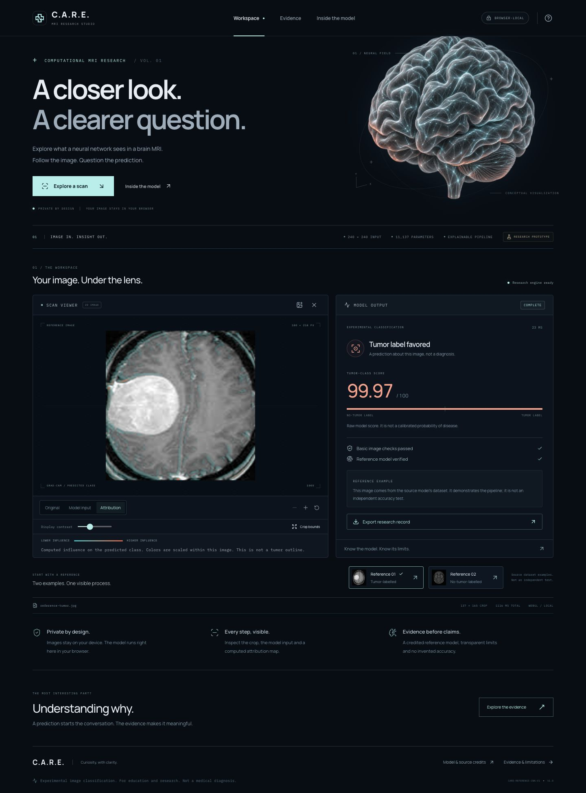

# C.A.R.E. — MRI Research Studio

[Open the public C.A.R.E. studio](https://care-mri-research-studio.tocodex42.chatgpt.site/) · [Download the offline fair build](releases/C.A.R.E.-Science-Fair.zip)



A rebuilt MRI image-classification research demo. React and TypeScript provide the interface; TensorFlow.js runs the credited reference CNN; self-hosted OpenCV.js handles preprocessing. Images are processed in the browser, with no image-upload API, analytics, database or external inference service.

The application, interaction design, browser inference pipeline, quality gates, model attribution, offline packaging and research workflow were rebuilt. **The shipped model weights remain the explicitly credited public baseline. No new clinical accuracy or independently measured MRI performance is claimed.**

## Open it

For the science-fair computer, extract [`releases/C.A.R.E.-Science-Fair.zip`](releases/C.A.R.E.-Science-Fair.zip) and follow `START-HERE.txt`. That build needs Python 3 only to serve static files; it needs no Python packages, account, Node installation or Internet connection.

For development, use Node 22.12 or newer:

```sh
npm ci
npm run prepare:assets
npm run dev
```

The Vite terminal prints the local URL. To build and run the production version:

```sh
npm run build
python3 serve.py
```

Default portable URL: `http://127.0.0.1:8765/`. `python3 serve.py --port 8766` selects another port. The launcher binds to loopback; it is not an Internet-facing inference server.

## What works

- JPG/PNG selection and drag-and-drop; two bundled reference MRI examples.
- Browser-local checks for unreadable files, excessive file size/pixel count, undersized images, low contrast and obvious high-frequency noise. These do not establish MRI identity.
- Training-compatible BGR preprocessing: grayscale blur, threshold 45, two erosions/dilations, largest-contour exclusive crop, cubic 240 × 240 resize and division by 255.
- SHA-256-verified reference weights, GPU inference with a CPU fallback, a raw tumor-class score and an explicit decision threshold.
- Original image, actual processed input and computed Grad-CAM for the predicted class. The attribution map is aligned with the model input and is not a tumor segmentation. Colors are normalized within each image, with gamma-scaled opacity for visibility; intensities cannot be compared quantitatively across images.
- Display-only contrast, crop bounds, zoom and reset. Display controls do not alter the tensor used for prediction.
- Last five successful analyses in memory; JSON research-record downloads with hashes, model identity, quality statistics, crop and actual processing times. Image pixels are not included in the JSON.
- Evidence and interactive pipeline views; keyboard navigation, reduced-motion support and responsive layouts.
- Production offline cache for the application, model and public reference assets. User image blobs and analysis records are not persisted by the application. The browser can retain files a user explicitly downloads.

## Model and evidence

The original model is by [Mohamed Ali Habib](https://github.com/MohamedAliHabib/Brain-Tumor-Detection/tree/30470ae8eb2e4a523df7dc45dd5323903cb98365). Source checkpoint SHA-256:

```text
e14c6af5b389c603242b171db841c407b6bfe65150b0d32dbd6590ec4d178e8f
```

The browser export contains the same eight float32 weight arrays, totalling 44,548 bytes and 11,137 parameters. `research/export_baseline.py` reproduces the export from an audited source checkpoint. The selected HDF5 model is not needed at runtime.

`tests/model-parity-results.json` records numerical comparison of the actual JavaScript engine against Python/OpenCV reference tensors. Both fixtures agree within 0.00002; the largest observed absolute score difference in the CPU check was approximately 8.57 × 10⁻⁸. Repeated inference did not increase the retained tensor count. This is a compatibility check, not an accuracy study.

The original experiment augments images before randomly splitting them, creating a leakage risk. Its historical 91% validation and approximately 89% test accuracy are attributed source reports, not this release's verified results. Reference images may be familiar to that model. A model score is not a calibrated probability of disease, and a no-tumor classification on one image does not establish a person's health.

## Verification

```sh
npm test
python3 -m unittest discover -s research -p 'test_*.py' -v
```

The second command needs the research dependencies. The six research integrity tests cover grouping, duplicate leakage, metric correctness, invalid inputs and exact reference preprocessing. The full split → one-epoch training → saved-model evaluation workflow was also exercised on **synthetic software-test images only**. Those synthetic results are not included as MRI evidence and their model is not shipped.

Browser QA and its limits are recorded in `tests/BROWSER-QA.md`. See `DEMO-GUIDE.md` for the fair presentation sequence.

## A fresh experiment

`research/workflow.py` supplies split, train and evaluate commands; see `research/README.md`. The workflow freezes group-aware splits before augmentation, refuses exact duplicate content assigned to different groups, stores image/model hashes, selects a model on validation data, and evaluates the held-out test set separately with confusion counts and group-bootstrap intervals.

No new MRI dataset was supplied for this rebuild. Supplying credible group IDs and reviewing near-duplicates remain human responsibilities. These tools cannot verify patient independence from filenames. A newly trained model requires reviewed evidence and a separately versioned browser export before replacing the credited baseline.

## Structure

```text
src/components/       workspace, viewer, results, evidence, model explorer
src/lib/              preprocessing, inference, attribution, record export
public/models/        audited browser weight arrays, manifest and source license
public/samples/       two credited source-dataset reference examples
public/vendor/        self-hosted OpenCV.js
research/             reproducible split/train/evaluate and integrity tests
scripts/              asset preparation, parity verification, offline packaging
tests/                fixed numerical fixtures and QA evidence
releases/             portable offline fair build
docs/                 desktop preview
assessment/           original files and initial assessment evidence
```

Artwork was created with the built-in image-generation tool, then copied into this project at `public/assets/brain-hero.png`. The complete final prompt and asset provenance are in [ASSETS.md](ASSETS.md). Model/code, image-source and dependency credits are in [THIRD-PARTY-NOTICES.md](THIRD-PARTY-NOTICES.md).

## License

The repository’s MIT license applies to the project’s original code. The reference model, MRI examples, fonts, OpenCV and other dependencies have their own licenses or source notices; see [THIRD-PARTY-NOTICES.md](THIRD-PARTY-NOTICES.md).
